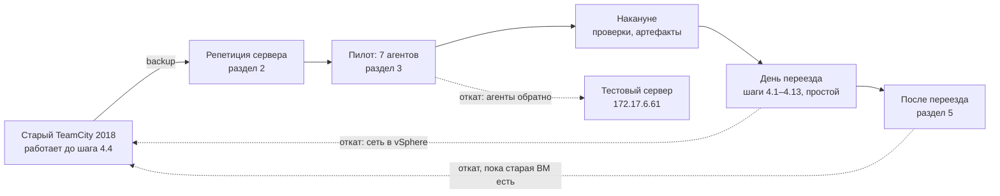

# Переезд TeamCity 2018.1.3 → 2026.2: пошагово

Новая ВМ `deb-13-test-teamcity` (сейчас `172.17.5.68`) с TeamCity 2026.2 и https забирает IP и имя старого сервера `teamcity.inc.elara.local`. Старая ВМ не меняется и остаётся точкой отката. Что делают плейбуки — [README.md](README.md), настройки и подробности — [docs/reference.md](docs/reference.md).

**Содержание**

- [Как устроен переезд](#как-устроен-переезд)
- [Когда откатываться](#когда-откатываться)
- [1. Подготовка](#1-подготовка)
- [2. Репетиция сервера](#2-репетиция-сервера)
- [3. Пилот: 7 агентов](#3-пилот-7-агентов)
- [4. День переезда](#4-день-переезда)
- [5. После переезда](#5-после-переезда)
- [Частые ошибки](#частые-ошибки)

## Как устроен переезд

```text
до:     teamcity.inc.elara.local → <СТАРЫЙ_IP> → старый TeamCity 2018 (http)
после:  teamcity.inc.elara.local → <СТАРЫЙ_IP> → новая ВМ, TeamCity 2026 (https, http → https)
откат:  сеть новой ВМ выкл., сеть старого сервера вкл.
```



> [!IMPORTANT]
> Обе машины никогда не должны быть в сети с одним IP одновременно. DNS не меняется.

Команды Ansible — на control node, из папки проекта, от своего пользователя, без `sudo`.

## Когда откатываться

Откатываться, если в окне простоя не удаётся быстро исправить:

- `50` падает на восстановлении или обновлении данных, TeamCity не выходит в рабочий режим;
- пользователи не входят, нет проектов или истории сборок;
- агенты не подключаются к новому серверу;
- пробные сборки на Linux и Windows (4.13) падают из-за нового сервера.

Точка невозврата:

- обновление данных 2018 → 2026 необратимо, но только на новой ВМ; старая ВМ не меняется — она и есть цель отката;
- решать до 4.13: после открытия сборок откат теряет всё, что сделано на новом сервере (сборки, артефакты, изменения настроек);
- старую ВМ держать отключённой 2–4 недели (раздел 5); после её удаления отката нет.

## 1. Подготовка

Один раз, без простоя.

### 1.1. Control node

- [ ] Debian 13, пакеты, SSH-ключ без пароля:

```bash
sudo apt install -y ansible python3-winrm sshpass rsync
ansible --version | head -1          # ansible [core 2.19.x]
ls ~/.ssh/id_ed25519.pub || ssh-keygen -t ed25519 -N '' -f ~/.ssh/id_ed25519
```

`sshpass` нужен для `--ask-pass` (`00` и первый запуск `60` на Linux-агентах), `rsync` — для `40`/`50`, `python3-winrm` — для Windows-агентов. Пароль на ключ не ставить: `00` и `60` входят по ключу без запросов (BatchMode).

- [ ] Проект: `git clone https://github.com/npushkarev/teamcity-ansible.git` или `git pull`. Проект из ZIP — `chmod -R go-w .`, иначе Ansible не прочитает `ansible.cfg`. В новую папку перенести `inventory/hosts.yml`, `inventory/vault.yml`, `migration/`, `files/tls/`, `files/ca/ca.crt`, `files/teamcity-agent/jdk/`.
- [ ] Сеть с control node: SSH (22) — новая ВМ, старый сервер, Linux-агенты; WinRM (5985) — Windows-агенты; https (443) — новый сервер (дистрибутив агента и REST).

### 1.2. Файлы

- [ ] `files/ca/ca.crt` — корпоративный УЦ в PEM ([files/ca](files/ca/README.md)); `openssl x509 -in files/ca/ca.crt -noout -subject -enddate` показывает УЦ и срок.
- [ ] `files/tls/` — ровно один сертификат `*.inc.elara.local` (`.cer`/`.crt`/`.pem`/`.der`, лучше с промежуточным УЦ) и один ключ `.key` ([files/tls](files/tls/README.md)).
- [ ] **Образы в ProGet:** `library/teamcity-server` с тегом `2026.2-unlimited` и `library/postgres:16`. Если тег сервера другой — в `hosts.yml`: `teamcity_registry_server_image: proget.inc.elara.local/main/library/teamcity-server:<тег>`.
- [ ] `files/teamcity-agent/jdk/` — Java 21 для агентов, к дню переезда; пилоту не нужна ([files/teamcity-agent](files/teamcity-agent/README.md)).

### 1.3. Inventory и vault

```bash
cp inventory/hosts.example.yml inventory/hosts.yml
nano inventory/hosts.yml       # у ВМ ansible_host: 172.17.5.68; у Windows ansible_user: 'INC\<учётка>'
```

В `hosts.example.yml` уже есть группы агентов: `teamcity_agents_linux` (20 машин, вместе с `ba-rosa-01` и `ba-deb-test`), `teamcity_agents_windows` (11, с настройками WinRM) и `pilot` (7). Переменные для отдельных агентов — [docs/reference.md](docs/reference.md#агенты-переменные).

```bash
cp inventory/vault.example.yml inventory/vault.yml
openssl rand -hex 24                         # пароль PostgreSQL
nano inventory/vault.yml                     # заполнить до шифрования
grep -n CHANGE_ME inventory/vault.yml        # остались только строки, которые заполните позже
ansible-vault encrypt inventory/vault.yml
```

Дальше правка: `EDITOR=nano ansible-vault edit inventory/vault.yml`.

| Ключ | Что | Нужен к шагу |
|---|---|---|
| `vault_teamcity_db_password` | пароль PostgreSQL: от 16 символов `A-Z a-z 0-9 _ -`; после первого запуска не менять | 2.3 |
| `vault_proget_registry_user`, `vault_proget_registry_password` | вход в ProGet; по API-ключу логин `api`, пароль — ключ | 2.3 |
| `proxy_host`, `proxy_port`, `proxy_user`, `proxy_password` | прокси для apt, если нужен | 1.4 |
| `vault_teamcity_admin_token` | токен администратора: копии — для пилота, нового сервера — в день переезда | 3.3, 4.10 |
| `vault_windows_admin_password` | пароль доменной учётки WinRM | 3.4 |
| `vault_agent_service_password` | пароль учётки службы старого Windows-агента, если она не LocalSystem; у хоста в `hosts.yml`: `teamcity_agent_service_password: "{{ vault_agent_service_password }}"` | 4.11 |

> [!NOTE]
> `vault.yml` лежит не в `group_vars`: плейбуки читают его сами. Разовым командам `ansible` нужен `-e @inventory/vault.yml --ask-vault-pass`.

### 1.4. Новая ВМ: 00 и 01

**1.** vSphere, ВМ выключена, **Edit Settings**: размер диска (сколько — 1.5; snapshots быть не должно — с ними диск не увеличить), память и CPU (рекомендуется 4 CPU, 8 ГБ RAM), у сетевого адаптера **Connected** и **Connect At Power On**.

**2.** Включить ВМ. В консоли `ip a` → IP в `ansible_host`. Root должен входить по SSH с паролем (`PermitRootLogin yes`): `ssh root@172.17.5.68 true`.

**3.** Подготовка Debian:

```bash
H=deb-13-test-teamcity.inc.elara.local
ansible-playbook playbooks/00-bootstrap-keys.yml --limit $H --ask-pass --ask-vault-pass
```

Ожидаемо: в итоге `ключ ssh : работает`. Вывод называет следующим `53` — при переносе он входит в `50`, отдельно не нужен.

**4.** Snapshot ВМ в vSphere, затем расширение корня.

> [!WARNING]
> `01` меняет таблицу разделов живого корня: удаляет swap и extended после корня, может перезагрузить ВМ. Только после snapshot и только с `--limit $H`: сам `01` `--limit` не проверяет и без него пойдёт на все хосты inventory, включая агентов.

```bash
ansible-playbook playbooks/01-expand-root.yml --limit $H -e expand_root_confirm=yes
ssh root@172.17.5.68 'df -h /; swapon --show'      # / — на весь диск, swap — /swapfile
```

Ожидаемо: `EXPAND-ROOT … корень … растянут на весь диск`. Откат — вернуть snapshot. Всё в порядке — удалить snapshot: он растёт при восстановлении и не даст снова увеличить диск.

**5.** DNS: `getent hosts deb-13-test-teamcity.inc.elara.local` → `172.17.5.68`. Нет записи — завести: без неё копия не откроется по имени, а пилот остановится на «Имя сервера не разрешается».

### 1.5. Старый сервер и сеть

```bash
OLD=root@teamcity.inc.elara.local
ssh $OLD 'command -v rsync; du -sh /data/teamcity-data/system/artifacts; ls -lht /data/teamcity-data/backup | head -n 3; df -h /data'
ssh $OLD 'ip -br a; ip r; cat /etc/resolv.conf'     # записать: <СТАРЫЙ_IP>/<ПРЕФИКС>, шлюз, DNS
df -h .                                             # место на control node
```

- [ ] Root входит на старый сервер по SSH, `rsync` там есть.
- [ ] Место: на control node — под backup и артефакты; диск ВМ — не меньше 2 × (backup + артефакты) с запасом: на ВМ лежат и копия backup, и восстановленные данные.
- [ ] Сеть старого сервера записана (после 4.4 её не посмотреть); в vSphere у новой ВМ та же сеть (port group).
- [ ] На старой ВМ нет других сервисов: после 4.4 они станут недоступны.
- [ ] `arping` на новой ВМ: `ssh root@172.17.5.68 'apt-get install -y iputils-arping'`.
- [ ] Как новая ВМ получает адрес: `ssh root@172.17.5.68 'ip -br a; grep -B1 -A4 "^iface" /etc/network/interfaces'`. `inet static` — адрес меняете сами (4.8). `inet dhcp` — с сетевыми админами заранее только договориться: резервирование `<СТАРЫЙ_IP>` на MAC новой ВМ переносится в окне, после 4.4, иначе ВМ возьмёт адрес, пока старый сервер в сети. Проще — в 4.8 перевести ВМ на `inet static`.

## 2. Репетиция сервера

Без простоя: старый сервер работает, на новой ВМ появляется его копия `https://deb-13-test-teamcity.inc.elara.local`.

### Раскатка

**2.1. Старый TeamCity: backup.** **Administration → Backup**, scope *Custom*, все галочки (база, настройки, логи сборок, personal changes), **Start Backup**. Ожидаемо: `Backup completed successfully`, файл в `/data/teamcity-data/backup/`.

**2.2. Control node: забрать backup и артефакты.** Артефактов в ZIP нет: без `migration/artifacts/` история сборок будет без них.

```bash
OLD=root@teamcity.inc.elara.local
mkdir -p migration/artifacts
ssh $OLD 'ls -t /data/teamcity-data/backup/*.zip | head -1'             # имя свежего архива
scp $OLD:/data/teamcity-data/backup/<имя>.zip migration/TeamCity_Backup.zip
rsync -a --partial $OLD:/data/teamcity-data/system/artifacts/ migration/artifacts/
```

В `migration/` — только архив и `artifacts/`: `40` копирует на ВМ всё содержимое папки.

**2.3. Control node: копия на новой ВМ.** `teamcity_public_name` пока не задавать: адрес копии — имя ВМ. Есть на старом сервере Cloud Profiles — копия сразу после запуска может поднимать облачных агентов: выключить их первым делом (2.4).

```bash
H=deb-13-test-teamcity.inc.elara.local
ansible-playbook playbooks/50-teamcity-migrate.yml --limit $H --ask-vault-pass
```

Ожидаемо: в конце `Готово` и `TeamCity: https://deb-13-test-teamcity.inc.elara.local`. Плейбук ждёт восстановления до 4 ч, обновления данных — до 1 ч. Ошибка — [Частые ошибки](#частые-ошибки) и журнал на ВМ `/opt/teamcity-2026/restore.log`.

> [!WARNING]
> Подсказку из `Готово` про агентов (`serverUrl` в `buildAgent.properties`, затем Authorize) не выполнять: рабочий агент 2018 уйдёт на копию, начнёт брать там настоящие сборки и обновится с сервера 2026 в своём каталоге. Агентов переносит только `60` (раздел 3).

**2.4. Браузер: проверить копию и закрыть её от настоящей работы.**

- [ ] **Cloud Profiles** — выключить (первым делом);
- [ ] вход старыми пользователями, проекты, история, артефакты на месте;
- [ ] **Administration → Plugins**: внешние плагины старого сервера загружены;
- [ ] **Administration → Global Settings**: Server URL = `https://deb-13-test-teamcity.inc.elara.local`;
- [ ] **Build Queue** — удалить очередь, восстановленную из backup;
- [ ] уведомления (**Email Notifier**) — выключить.

Триггеры можно не выключать: агенты на копии выключены (раздел 3), сборки только встают в очередь.

> [!WARNING]
> В проектах с Versioned Settings на копии ничего не менять: изменения уйдут коммитом в репозиторий настроек рабочего сервера.

**2.5. Записать время** backup (2.1), копирования (2.2) и `50` (2.3): по нему считается окно простоя (раздел 4, «Накануне»).

### Откат

Старый сервер не менялся (backup — из UI на работающем сервере, копирование — по SSH): откатывать на нём нечего.

Убрать копию — для новой попытки восстановления или после репетиции:

> [!WARNING]
> Удаляет базу и Data Directory копии на новой ВМ.

```bash
ssh root@172.17.5.68 'cd /opt/teamcity-2026 && docker compose down -v && rm -f .restored .upgraded'
```

Остаются Docker, образы, `compose.yaml`, nginx с сертификатом и `/srv/teamcity-migration`: следующий `50` восстановит заново. Пилотные агенты после этого без сервера, пока их не вернуть (3.8) или не перенести (4.11).

Восстановление оборвалось посередине (`50` пишет `На ВМ уже есть тома …`): дождаться, пока в `ssh root@172.17.5.68 docker ps` пропадёт контейнер с `maintainDB.sh` (восстановление идёт и без плейбука), посмотреть `/opt/teamcity-2026/restore.log`, затем команда выше и снова `50`.

## 3. Пилот: 7 агентов

Linux `ba-deb-02`, `ba-deb-06`, `ba-deb-test`; Windows `ba-w22-01`, `ba-w22-03`, `ba-win-01`, `ba-win-10` (все `*.inc.elara.local`, группа `pilot`). Их новые агенты `<старое имя>-2026` сейчас работают с тестовым `http://172.17.6.61:8111`.

`60` с `teamcity_agents_keep_old=true` перенаправляет новых агентов на копию, авторизует, ставит в пулы старых и выключает (Disabled), чтобы на копии не пошли настоящие сборки. Старые агенты 2018 не трогаются и работают со старым сервером. Нужно: разделы 1–2.

### Раскатка

**3.1. Control node готов.**

```bash
git pull
ansible --version | head -1          # ansible [core 2.19.x]
sudo apt install -y ansible python3-winrm sshpass rsync
ls ~/.ssh/id_ed25519.pub || ssh-keygen -t ed25519 -N '' -f ~/.ssh/id_ed25519
ls -l files/ca/ca.crt files/tls/     # УЦ; один сертификат и один ключ
```

Java (`files/teamcity-agent/jdk/`) для пилота не нужна: на 7 агентах Java 21 уже стоит. Она нужна в день переезда.

**3.2. Inventory агентов.** В `inventory/hosts.yml` скопировать из `hosts.example.yml` группы `teamcity_agents_linux`, `teamcity_agents_windows` и `pilot`; вместо `INC\svc-ansible` — настоящая доменная учётка, в одинарных кавычках.

```bash
ansible pilot --list-hosts                                          # hosts (7)
for h in $(ansible pilot --list-hosts | tail -n +2); do getent hosts $h >/dev/null && echo "ok $h" || echo "НЕТ DNS: $h"; done
ansible-vault view inventory/vault.yml | grep -oE '^[A-Za-z_]+:'    # только имена ключей
```

`НЕТ DNS` — у этого хоста в `hosts.yml` `ansible_host: <IP>`.

**3.3. Копия и токен.** Браузер, `https://deb-13-test-teamcity.inc.elara.local`: открывается, старые пользователи входят, проекты на месте; **Build Queue** — очередь из backup удалена, **Cloud Profiles** — выключены (2.4). Затем под администратором (System Administrator): **Profile → Access Tokens → Create**, права не ограничивать.

```bash
EDITOR=nano ansible-vault edit inventory/vault.yml       # vault_teamcity_admin_token: "<ТОКЕН>"
read -rs T; curl -s -o /dev/null -w '%{http_code}\n' --cacert files/ca/ca.crt -H "Authorization: Bearer $T" https://deb-13-test-teamcity.inc.elara.local/app/rest/server; unset T
```

Ожидаемо: `200`. `401` — не тот токен или истёк; `000` — УЦ, DNS или сеть с control node.

> [!IMPORTANT]
> Без токена `60` не авторизует и не выключит агентов на копии. Вручную на копии агентов не авторизовывать: включённый агент возьмёт настоящие сборки.

**3.4. Доступ к агентам.**

```bash
ansible 'pilot:&teamcity_agents_linux' -m raw -a 'id -u' --ask-pass                                            # 3 × 0
ansible 'pilot:&teamcity_agents_windows' -m ansible.windows.win_ping -e @inventory/vault.yml --ask-vault-pass   # 4 × "pong"
```

- Linux: root входит по SSH с паролем (или ключ control node уже в `/root/.ssh/authorized_keys`). `--ask-pass` спрашивает один пароль на все хосты: разные пароли — по хосту, `--limit <FQDN>`.
- Windows без `pong`: на Windows 10 один раз `Enable-PSRemoting -Force`; открыт порт 5985; учётка — в локальных Administrators; ошибка про ntlm/spnego — `sudo apt install -y python3-requests-ntlm python3-spnego`.

**3.5. Перед запуском.**

- [ ] предупредить: 7 агентов уходят с `172.17.6.61` на копию, сборки на `172.17.6.61` их теряют;
- [ ] новые агенты на `172.17.6.61` — Idle: сборка дольше 10 минут (`teamcity_agents_wait`, 600 с) — агент пропускается с `ЖДЁТ СБОРКУ`;
- [ ] старые агенты 2018 не трогаются.

**3.6. Запуск по шагам: Linux, один Windows, остальные Windows.**

```bash
U=https://deb-13-test-teamcity.inc.elara.local
ansible-playbook playbooks/60-teamcity-agents.yml --limit 'pilot:&teamcity_agents_linux' \
  --ask-pass --ask-vault-pass -e teamcity_agents_keep_old=true -e teamcity_agents_server_url=$U
ansible-playbook playbooks/60-teamcity-agents.yml --limit ba-w22-01.inc.elara.local \
  --ask-vault-pass -e teamcity_agents_keep_old=true -e teamcity_agents_server_url=$U
ansible-playbook playbooks/60-teamcity-agents.yml --limit 'pilot:&teamcity_agents_windows' \
  --ask-vault-pass -e teamcity_agents_keep_old=true -e teamcity_agents_server_url=$U
```

Ожидаемо, в блоке `Итог переноса агентов` по строке на хост:

```text
ba-deb-02.inc.elara.local: перенаправлен на новый сервер, старый оставлен (keep_old); ba-deb-02-2026: авторизован, пул <пул>, ВЫКЛЮЧЕН — репетиция: для пробной сборки Agents → Enable
```

В третьем запуске `ba-w22-01` уже готов: `уже на новом сервере, старый оставлен (keep_old); …: авторизован, пул <пул>, выключен (Agents → Enable)` — ничего не меняется.

Смотреть итог, а не `PLAY RECAP`: хост с ошибкой помечается упавшим только в самом конце, `ЖДЁТ СБОРКУ` упавшим не считается.

Если не так:

- `ЖДЁТ СБОРКУ` — дождаться сборки на новом агенте и повторить команду с `--limit <FQDN>`;
- `ОШИБКА («<шаг>»)` — причина в той же строке, действия — [Частые ошибки](#частые-ошибки). Windows: при неудачном перенаправлении прежний `buildAgent.properties` сам не возвращается — агент не на `172.17.6.61`, пока не сделан 3.8;
- `авторизуйте в TeamCity вручную (нет vault_teamcity_admin_token)` — нет токена (3.3);
- Linux: `пул Default` без подсказки — старый агент не в `/opt/buildAgent`: у хоста `teamcity_agent_old_dir`;
- для разбора — фото блока `Итог переноса агентов` и первой красной строки `fatal:` или `ОШИБКА`; `vault.yml` и токены не фотографировать.

**3.7. Проверка в копии.** **Agents**: 7 агентов `-2026` — Connected, авторизованы, Disabled (так задумано), пулы — как у старых агентов. Пробная сборка: очистить **Build Queue** → **Enable** одного агента → сборка без деплоя → снова **Disable**.

> [!WARNING]
> Включённый агент на копии берёт любую подходящую сборку из очереди, в том числе по триггерам. Повторный `60` включённого вручную агента не выключает.

### Откат

**3.8. Вернуть агента на `172.17.6.61`** (агент Idle). Без отката в день переезда `60` сам перенаправит эти агенты с копии на финальный адрес; до тех пор `172.17.6.61` без них.

Linux, root на агенте:

```bash
f=/opt/buildAgent2026/conf/buildAgent.properties
grep -H '^serverUrl' "$f".bak-repoint-*                          # какая копия смотрит на 172.17.6.61
b=$(grep -l '172\.17\.6\.61' "$f".bak-repoint-* | tail -n 1)     # самая поздняя такая копия
cp -p "$b" "$f" && systemctl restart teamcity-agent2026
```

Windows, PowerShell от администратора:

```powershell
$f = 'C:\BuildAgent2026\conf\buildAgent.properties'
Select-String -Path "$f.bak-repoint-*" -Pattern '^serverUrl'     # какая копия смотрит на 172.17.6.61
$b = (Get-ChildItem "$f.bak-repoint-*" | Sort-Object Name | Select-String -Pattern '172\.17\.6\.61' -List | Select-Object -Last 1).Path
Copy-Item -LiteralPath $b -Destination $f -Force; Restart-Service TCBuildAgent2026
```

Ожидаемо: `<имя>-2026` снова Connected на `http://172.17.6.61:8111` — в копии файла прежний токен, авторизация там сохранилась. На копии запись агента станет Disconnected. Остаются сертификаты в `conf/trustedCertificates`, ключ control node и УЦ в системе — работе не мешают. `buildAgent.properties` целиком не выводить: в нём токен агента.

## 4. День переезда

### Накануне

- [ ] **Окно простоя** = backup + копирование + `50` (время из 2.5) + смена IP + `60` для всех агентов + проверки + запас. `60` переносит агентов по одному; на агента: ожидание текущей сборки — до 10 мин, регистрация — до 2 мин (до 10 мин, если агент обновляется), авторизация — до 3 мин; у Windows ещё копирование ~600 МБ и регистрация до 5 мин. Пилот (только перенаправление) быстрее полной установки.

> [!TIP]
> Окно короче, если заранее поставить новых агентов на все машины так же, как пилот (`keep_old`, на копию): в окне `60` их только перенаправит. Параметры `system.*`/`env.*` старых агентов тогда переносятся в момент установки.

- [ ] Объявить окно.
- [ ] Артефакты — заранее, в окне докачается разница (в `migration/` ещё архив репетиции — так и нужно, в окне он заменится):

```bash
H=deb-13-test-teamcity.inc.elara.local
rsync -a --partial root@teamcity.inc.elara.local:/data/teamcity-data/system/artifacts/ migration/artifacts/
ansible-playbook playbooks/40-teamcity-backup-upload.yml --limit $H
```

- [ ] Java 21 в `files/teamcity-agent/jdk/` — два `.deb` и Corretto `.zip`, настоящие файлы, не указатели LFS ([files/teamcity-agent](files/teamcity-agent/README.md)): в `ls -l files/teamcity-agent/jdk/` нет файлов по ~134 байта.
- [ ] Доступ и DNS всех агентов:

```bash
ansible teamcity_agents_linux -m raw -a 'id -u' --ask-pass                                            # 20 × 0
ansible teamcity_agents_windows -m ansible.windows.win_ping -e @inventory/vault.yml --ask-vault-pass   # 11 × "pong"
for h in $(ansible 'teamcity_agents_linux:teamcity_agents_windows' --list-hosts | tail -n +2); do getent hosts $h >/dev/null && echo "ok $h" || echo "НЕТ DNS: $h"; done
```

- [ ] Новый агент стоит только у `pilot`:

```bash
ansible teamcity_agents_linux -m raw -a "grep -H '^serverUrl' /opt/buildAgent2026/conf/buildAgent.properties 2>/dev/null || echo NONE" --ask-pass
ansible teamcity_agents_windows -m ansible.windows.win_shell -a 'Test-Path C:\BuildAgent2026\conf\buildAgent.properties' -e @inventory/vault.yml --ask-vault-pass
```

У хоста не из `pilot` есть `serverUrl` или `True` — `60` его только перенаправит, без параметров `system.*`/`env.*` старого агента. Linux: после 4.11 повторить `60` для хоста (4.12) — скрипт допишет недостающие параметры. Windows: сверить параметры с `buildAgent.properties` старого агента вручную.

- [ ] Учётки служб старых Windows-агентов: не `LocalSystem` — пароль в vault и у хоста (1.3):

```bash
ansible teamcity_agents_windows -m ansible.windows.win_shell -a 'Get-CimInstance Win32_Service | Where-Object PathName -like "*launcher*" | Select-Object Name, StartName' -e @inventory/vault.yml --ask-vault-pass
```

- [ ] vSphere: доступ к обеим ВМ (сетевой адаптер и консоль).
- [ ] DHCP: сетевые админы готовы перенести резервирование в окне, после 4.4 (1.5).

### Раскатка: сервер (4.1–4.10)

```bash
H=deb-13-test-teamcity.inc.elara.local     # имя ВМ в hosts.yml — не меняется и после смены IP
OLD=root@teamcity.inc.elara.local
```

**4.1. Старый TeamCity: остановить запуск сборок.** **Build Queue → Pause** (если кнопки нет — **Agents** → выключить агентов). Дождаться окончания идущих сборок. Предупредить: настройки больше не менять.

**4.2. Старый TeamCity: backup.** **Administration → Backup**, *Custom*, все галочки. Ожидаемо: `Backup completed successfully`. UI-backup не запускается — [запасной вариант](docs/reference.md#backup-без-ui-запасной-вариант).

**4.3. Control node: backup и разница артефактов.**

```bash
ssh $OLD 'ls -t /data/teamcity-data/backup/*.zip | head -1'
scp $OLD:/data/teamcity-data/backup/<имя>.zip migration/TeamCity_Backup.zip     # заменяет архив репетиции
rsync -a --partial $OLD:/data/teamcity-data/system/artifacts/ migration/artifacts/
```

**4.4. vSphere: отключить старый сервер от сети.** **Edit Settings** → сетевой адаптер → снять **Connected**. ВМ не выключать: она — точка отката. DHCP: сетевые админы переносят резервирование сейчас.

**4.5. Удалить данные репетиции на новой ВМ.**

> [!WARNING]
> Удаляет базу и Data Directory копии, вместе с токеном из 3.3.

```bash
ssh root@172.17.5.68 'cd /opt/teamcity-2026 && docker compose down -v && rm -f .restored .upgraded'
ssh root@172.17.5.68 'docker volume ls -q --filter label=com.docker.compose.project=teamcity-2026'   # пусто
```

**4.6. `hosts.yml`: адрес сервера.** В `vars` группы `teamcity`: `teamcity_public_name: teamcity.inc.elara.local`.

**4.7. Восстановление, обновление 2018 → 2026, https.**

```bash
ansible-playbook playbooks/50-teamcity-migrate.yml --limit $H --ask-vault-pass
```

Ожидаемо: `Готово`, `TeamCity: https://teamcity.inc.elara.local`. Подсказку про агентов не выполнять (2.3).

**4.8. Консоль vSphere новой ВМ: IP → `<СТАРЫЙ_IP>`.** Только в консоли: SSH по прежнему адресу отвалится.

```bash
ip -br a                              # имя интерфейса, например ens192
nano /etc/network/interfaces          # inet dhcp → inet static, пример ниже
systemctl restart networking          # адрес не сменился — reboot
arping -U -c 3 -I ens192 <СТАРЫЙ_IP>  # сообщить сети новый MAC (иначе до нескольких минут недоступности)
ip -br a                              # ожидаемо: <СТАРЫЙ_IP>
```

```text
iface ens192 inet static
    address <СТАРЫЙ_IP>/<ПРЕФИКС>
    gateway <ШЛЮЗ>
```

Значения — из 1.5. DHCP: после переноса резервирования — `systemctl restart networking` и `arping`.

**4.9. Control node: новый адрес и проверка.**

```bash
nano inventory/hosts.yml                              # у ВМ: ansible_host: <СТАРЫЙ_IP>
ssh-keygen -R <СТАРЫЙ_IP>; ssh-keygen -R teamcity.inc.elara.local
curl -sI http://teamcity.inc.elara.local/ | head -1   # HTTP/1.1 308 Permanent Redirect
```

Не `308` — отвечает старый сервер: проверить 4.4, повторить `arping` на новой ВМ. Браузер, `https://teamcity.inc.elara.local`: вход; **Administration → Global Settings**: Server URL = `https://teamcity.inc.elara.local`; **Build Queue** — на паузе до 4.13 (если нет — поставить).

**4.10. Токен администратора нового сервера** (токен 3.3 удалён в 4.5): **Profile → Access Tokens → Create**.

```bash
EDITOR=nano ansible-vault edit inventory/vault.yml       # vault_teamcity_admin_token: "<ТОКЕН>"
read -rs T; curl -s -o /dev/null -w '%{http_code}\n' --cacert files/ca/ca.crt -H "Authorization: Bearer $T" https://teamcity.inc.elara.local/app/rest/server; unset T   # 200
```

### Раскатка: агенты (4.11–4.13)

**4.11. Все агенты.**

> [!WARNING]
> Выключает старых агентов 2018 (после текущей сборки): со старым сервером они больше не работают. Только после 4.9.

```bash
ansible-playbook playbooks/60-teamcity-agents.yml --limit 'teamcity_agents_linux:teamcity_agents_windows' \
  --ask-pass --ask-vault-pass -e agents_confirm=yes
```

Адрес для агентов — `https://teamcity.inc.elara.local` (из 4.6). Блоков `Итог переноса агентов` два: Linux — в середине вывода, Windows — в конце. Ожидаемо, по строке на хост:

```text
<хост>: перенесён, старый выключен; <имя>-2026: авторизован, пул <пул>                                  ← Linux
<хост>: перенесён (новый агент рядом со старым), старый выключен; <имя>-2026: авторизован, пул <пул>   ← Windows
<хост>: перенаправлен на новый сервер, старый выключен; <имя>-2026: авторизован, пул <пул>             ← pilot
```

**4.12. Повтор для хостов, где в итоге не `старый выключен`.** Та же команда с полными именами из `hosts.yml`:

```bash
ansible-playbook playbooks/60-teamcity-agents.yml --limit ba-deb-01.inc.elara.local,ba-w22-02.inc.elara.local \
  --ask-pass --ask-vault-pass -e agents_confirm=yes
```

| В итоге | Состояние | Что делать |
|---|---|---|
| `ЖДЁТ СБОРКУ` | ничего не переключено, старый агент работает | после сборки — повтор |
| `старый агент ещё занят сборкой — запустите плейбук позже` | новый агент работает и авторизован, старый ещё включён | после сборки — повтор |
| `ОШИБКА («<шаг>»)`, `НЕДОСТУПЕН по SSH`, `НЕДОСТУПЕН по WinRM` | причина — в строке | [Частые ошибки](#частые-ошибки), затем повтор |
| `НЕ ПОДКЛЮЧИЛСЯ`, `НЕ АВТОРИЗОВАН`, `вручную` | агент переключён, авторизация или пул не сделаны | [Частые ошибки](#частые-ошибки) |

Переменную для одного хоста (`teamcity_agent_old_dir`, `teamcity_agent_old_autostart_checked` и другие) задавать у него в `hosts.yml`: `-e` действует на все хосты запуска.

**4.13. Новый TeamCity: проверка и открытие сборок.**

- [ ] **Agents**: все агенты `-2026` Connected, авторизованы, в своих пулах;
- [ ] **Build Queue** — снять паузу;
- [ ] пробная сборка на Linux и на Windows;
- [ ] объявить конец работ.

> [!NOTE]
> После 4.13 откат теряет всё, что сделано на новом сервере ([Когда откатываться](#когда-откатываться)).

### Откат: сервер

В любой момент, пока старая ВМ есть.

**1.** vSphere: у новой ВМ снять **Connected**, у старого сервера — поставить.

**2.** Проверка с control node:

```bash
curl -sI http://teamcity.inc.elara.local/ | head -1   # ответ старого сервера, не «308 Permanent Redirect»
```

Всё ещё `308` или нет ответа пару минут — на старом сервере (консоль vSphere) `arping -U -c 3 -I <интерфейс> <СТАРЫЙ_IP>` или перезапуск сети.

**3.** Старый TeamCity: снять паузу **Build Queue**; если в 4.1 выключали агентов — включить.

**4.** Если 4.11 уже был — откат агентов (ниже).

Возвращаемся к старому TeamCity 2018 с данными на момент 4.1: на нём ничего не менялось, записи агентов тоже. Новая ВМ с данными 2026 остаётся без сети — для разбора. Теряется всё, что сделано на новом сервере.

Повторная попытка: в консоли новой ВМ вернуть `172.17.5.68` (`/etc/network/interfaces`, `systemctl restart networking`), только потом **Connected**; в `hosts.yml` — `ansible_host: 172.17.5.68`; дальше — с 4.1 (4.5 удалит данные прошлой попытки).

### Откат: Linux-агенты

Плейбука отката нет: команды — на каждом агенте, их печатают скрипты в журналы `/root/teamcity-agent-migrate/`.

```bash
# control node: последние журналы всех Linux-агентов
ansible teamcity_agents_linux -m raw -a 'for f in $(ls -t /root/teamcity-agent-migrate/*.log | head -n 2); do echo "== $f"; tail -n 15 "$f"; done'
```

На агенте под root (`sudo` из напечатанных команд можно опустить):

1. `systemctl disable --now teamcity-agent2026`;
2. команды после `Вернуть старого агента:` (`migrate-*.log`) или `Включить старого агента обратно:` (`disable-old-*.log`). Обычно это `systemctl enable --now <служба>` или `sed`, снимающий пометку `#tcagent-off#` в cron или `rc.local` (копии этих файлов — в `/var/backups/teamcity-agent-linux/`).

Возвращается старый агент 2018, как до 4.11: его каталог не менялся. Остаются `/opt/buildAgent2026` (выключен), Java 21, УЦ в системе, ключ control node. Хост с `ЖДЁТ СБОРКУ` не переключался — возвращать нечего.

### Откат: Windows-агенты

```bash
# control node: имя и тип запуска старой службы на каждом агенте
ansible teamcity_agents_windows -m ansible.windows.win_shell -a 'Get-Content C:\ProgramData\teamcity-agent-migrate\old-service.json' -e @inventory/vault.yml --ask-vault-pass
```

Файла нет — `62` старую службу не выключал, возвращать нечего. На агенте, PowerShell от администратора:

```powershell
Set-Service TCBuildAgent2026 -StartupType Disabled; Stop-Service TCBuildAgent2026
Set-Service <name> -StartupType Automatic; Start-Service <name>    # name из old-service.json; start_mode Manual — -StartupType Manual
```

Готовая строка — в конце последнего `C:\ProgramData\teamcity-agent-migrate\disable-old-*.log` (`Включить старого агента обратно: …`). Возвращается старый агент, как до 4.11. Остаются `C:\BuildAgent2026` (служба выключена) и УЦ в `LocalMachine\Root`.

## 5. После переезда

### Раскатка

- [ ] Ссылки `http://teamcity.inc.elara.local/...` работают (перенаправление 308). Webhooks в Bitbucket со временем перевести на `https://`.
- [ ] У всех агентов в итоге `старый выключен` (повтор 4.12). Linux-хосты, где новый агент стоял заранее («Накануне»), — ещё раз `60`.
- [ ] Тестовый сервер `172.17.6.61` агентам больше не нужен.
- [ ] Когда `60` больше не нужен: токен из 4.10 удалить (**Profile → Access Tokens**), в vault `vault_teamcity_admin_token: ""`.
- [ ] Копии backup — в них пароли и токены — удалить:

```bash
ssh root@<СТАРЫЙ_IP> 'rm -rf /srv/teamcity-migration'     # копия backup и артефактов на ВМ
rm -rf migration/TeamCity_Backup.zip migration/artifacts    # control node
```

Повторный `50` после этого (например, новый сертификат в `files/tls/`) требует снова положить `migration/TeamCity_Backup.zip`: `40` проверяет архив. Восстановление не повторится: есть метка `/opt/teamcity-2026/.restored`.

- [ ] Через 2–4 недели: backup нового сервера (**Administration → Backup**), затем удалить старую ВМ.

### Откат

Пока старая ВМ есть — как в разделе 4 («Откат: сервер», «Откат: Linux-агенты», «Откат: Windows-агенты»), но теряется всё, что сделано на новом сервере после 4.13. После удаления старой ВМ отката нет.

## Частые ошибки

Все статусы `60` — [docs/reference.md](docs/reference.md#агенты-как-работает-60).

### Control node и Ansible

| Сообщение | Что делать |
|---|---|
| `Ansible is being run in a world writable directory` | `chmod -R go-w .` в папке проекта |
| `you must install the sshpass program` | `sudo apt install -y sshpass` |
| `Attempting to decrypt but no vault secrets found` | добавить `--ask-vault-pass` |
| `'vault_windows_admin_password' is undefined` | в разовой команде нет `-e @inventory/vault.yml` |
| `Could not match supplied host pattern` | в `--limit` — полное имя из `hosts.yml`: `ba-deb-01.inc.elara.local` |
| WinRM: ошибка про `ntlm`, `spnego`, `requests_ntlm` | `sudo apt install -y python3-requests-ntlm python3-spnego` |
| WinRM: `credentials were rejected` | `ansible_user` (`'INC\<учётка>'`), `vault_windows_admin_password`; учётка в локальных Administrators |
| `Запускайте с --limit <агенты> и -e agents_confirm=yes` | добавить флаг; пилот — `-e teamcity_agents_keep_old=true` |
| `На этой машине (control node) нет rsync` | `sudo apt install -y rsync` |

### Сервер: 00, 01, 40, 50, 53

| Сообщение | Что делать |
|---|---|
| `Только Debian 11/12/13` (`00`), `Only Debian 13 is supported` (`53`) | ВМ на Debian 13 |
| `Не найден SSH-ключ` (`00`) | ключ (1.1); запускать без `sudo` |
| `Нет файла корневого сертификата` (`00`) | `files/ca/ca.crt` |
| `Часы НЕ синхронизировались` (`00`) | UDP 123 до `172.17.0.2`, `172.17.0.7` (на ВМ `chronyc sources -v`) или время вручную и `-e bootstrap_time_sync=false` |
| `Вход по ключу НЕ работает` (`00`) | ключ — этого control node? sshd на ВМ работает? |
| `НЕ подтверждено` (`01`) | snapshot, затем `-e expand_root_confirm=yes` |
| `после корня не похож на swap/extended` (`01`) | разметка не «корень, затем swap»: расширять вручную; ничего не изменено |
| `Мало места на ВМ` (`40`) | увеличить диск в vSphere и выполнить `01` |
| `SHA-256 архива на ВМ не совпадает` (`40`) | запустить ещё раз |
| `В files/tls/ нужно ровно по одному файлу` (`сертификаты []`) | один сертификат `.cer`/`.crt`/`.pem`/`.der` и один ключ `.key` |
| `ключ не от этого сертификата`, `сертификат просрочен`, `сертификат не подходит к имени`, `ключ не читается` (`50`) | правильные файлы в `files/tls/`; ключ без пароля |
| `Check target architecture, image source, registry credentials` (`53`) | пароль PostgreSQL от 16 символов `A-Z a-z 0-9 _ -` (`openssl rand -hex 24`), логин и пароль ProGet в vault |
| `docker login ... не прошёл` | логин и пароль ProGet в vault (подсказки — в сообщении) |
| `На ВМ уже есть тома` (`50`) | раздел 2, «Откат» |
| `maintainDB restore завершился с ошибкой` (`50`) | `/opt/teamcity-2026/restore.log`; заново — раздел 2, «Откат» |
| `TeamCity не вышел в рабочий режим` (`50`) | на ВМ `docker compose -f /opt/teamcity-2026/compose.yaml logs --tail 200 server`; исправить и `50` ещё раз |
| `https работает, но сертификат не проверяется` (`50`) | в `files/tls/` — сертификат с промежуточным УЦ в том же файле |

### Агенты: 60

| Сообщение | Что делать |
|---|---|
| `НЕДОСТУПЕН по SSH`, `НЕДОСТУПЕН по WinRM` | машина выключена, нет сети, неверный пароль (`--ask-pass`, `vault_windows_admin_password`), root по паролю запрещён (`PermitRootLogin`), нет WinRM (`Enable-PSRemoting -Force`) |
| `вход не под root` | Linux-агенты — только `ansible_user: root`, `sudo` не поддерживается |
| `Имя сервера не разрешается` | DNS на агенте: `getent hosts <сервер>` |
| `RHEL 7-подобная система (ROSA 7.x/Cobalt)` | скрипты там не работают — переносить вручную |
| `нет Java 21 в /opt/teamcity-agent-jdk21 и нечем поставить` | нужный `.deb` в `files/teamcity-agent/jdk/` |
| `Не хватает на control node` | скрипты в `files/teamcity-agent/`, `files/ca/ca.crt` |
| `ОШИБКА («3d. https нового сервера с этой машины»)` | на агенте `curl -sI https://<сервер>/login.html`: DNS, порт 443, УЦ |
| `скрипт нашёл, что мешает переносу (пункты [НЕТ] выше)` | исправить пункты `[НЕТ]` из вывода и повторить; ничего не изменено |
| `перенос не удался (код N). Скрипт вернул старого агента` | журнал `migrate-*.log`; убрать нового — `teamcity-agent-linux-remove-new.sh` (на агент — `scp`, команда — в журнале) |
| `агент не зарегистрировался на … — возвращён прежний buildAgent.properties` (Linux) | обычно УЦ или сеть: строки журнала в выводе; исправить и повторить; старый агент не тронут |
| `новый агент не зарегистрировался на … — старый агент НЕ выключен` (Windows) | прежний файл сам не возвращается (копия `…bak-repoint-*`); журнал `C:\BuildAgent2026\logs\teamcity-agent.log`; исправить и повторить |
| `агент установлен, но не зарегистрировался за 5 минут` (Windows; `PKIX` — сертификаты) | `conf\trustedCertificates` и журнал агента; новый агент остаётся, повтор возьмёт его; убрать — `teamcity-agent-windows-remove-new.ps1 -Yes` |
| `по журналу зарегистрировался, но сервер не видит его подключённым` (Windows) | **Agents** и журнал агента, затем повтор; старый агент не выключен |
| `старого выключить не удалось` | вывод `disable-old` выше и журнал `disable-old-*.log`; новый агент работает; повтор |
| `недоступен (TrustFailure / SecureChannelFailure / NameResolutionFailure)` (Windows) | нет УЦ / TLS / DNS на машине — см. сообщение; затем повтор |
| `нужен пароль: teamcity_agent_service_password` (Windows) | пароль учётки службы в vault и у хоста (1.3) |
| `служб агентов N` … `задайте teamcity_agent_old_dir` (Windows) | `teamcity_agent_old_dir` у хоста |
| `старый агент запускается ещё и отсюда: task …` (Windows) | отключить задание планировщика или запись `Run` и повторить; если так и нужно — `teamcity_agent_old_autostart_checked: true` у хоста |
| `UNSAFE … owner …` (Windows, шаг 1b) | удалить `C:\ProgramData\teamcity-agent-migrate` от администратора и повторить |
| `недоделанная установка` (Windows) | `C:\ProgramData\teamcity-agent-migrate\teamcity-agent-windows-remove-new.ps1 -Yes`, затем повтор |
| `это указатель Git LFS, а не архив` | скачать Corretto кнопкой Download, сверить `SHA256SUMS` |
| `похоже, старый агент запускается отсюда: /var/spool/cron/…` (RPM) | закомментировать эту строку автозапуска; не агент — `teamcity_agent_rpm_autostart_checked: true` у хоста |
| `В /opt/buildAgent2026 агент другого сервера` | обновить проект: в `60` такой агент перенаправляется автоматически |

### REST: авторизация агентов

| Сообщение | Что делать |
|---|---|
| `НЕ АВТОРИЗОВАН (HTTP 500; лимит лицензии?)` | не хватает лицензий на агентов: **Administration → Licenses**; затем `60` ещё раз |
| `НЕ АВТОРИЗОВАН (HTTP 403; …)` | токен не администратора или с урезанными правами — новый токен (3.3, 4.10) |
| `REST HTTP 401`, `REST недоступен` | `vault_teamcity_admin_token` не того сервера или истёк; новый токен — **Profile → Access Tokens** |
| `НЕ ПОДКЛЮЧИЛСЯ к серверу за 3 минуты` | новый агент не дошёл до сервера: журнал агента |
| `записи старого агента … на сервере нет — пул выберите вручную` | пул вручную: **Agents → Pools** |
| `авторизуйте в TeamCity вручную (нет vault_teamcity_admin_token)` | токен (3.3, 4.10) и повтор; на копии вручную не авторизовывать |
