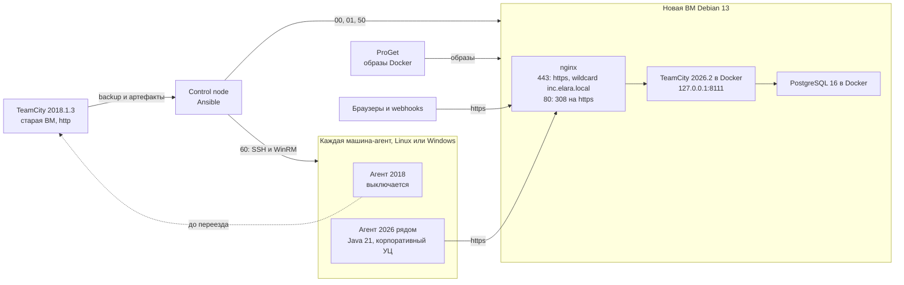

# TeamCity 2018 → 2026: перенос сервера и агентов

Ansible-плейбуки переносят TeamCity 2018.1.3 на новую ВМ (TeamCity 2026.2, https) и переводят на неё все ~30 агентов.

- Сервер: ВМ Debian 13, TeamCity 2026.2 и PostgreSQL 16 в Docker, данные — из backup старого сервера.
- Агенты (Linux и Windows): рядом со старым агентом ставится новый агент 2026, старый выключается.
- Переезд пошагово, с откатом на каждом этапе, — [MIGRATION.md](MIGRATION.md).

## Как устроено



- **День переезда:** новая ВМ забирает IP и имя `teamcity.inc.elara.local`, DNS не меняется. Старую ВМ только отключают от сети в vSphere — это точка отката.
- **Данные:** `50` восстанавливает backup 2018 в PostgreSQL и обновляет данные до 2026. Обновление необратимо, но только на новой ВМ.
- **Доступ:** TeamCity слушает только `127.0.0.1:8111`, снаружи — https через nginx; старые http-ссылки и webhooks работают через 308.
- **Агенты:** `60` ставит агента 2026 рядом со старым (`/opt/buildAgent2026`, `C:\BuildAgent2026`), авторизует его и ставит в пул старого. Старый выключается после текущей сборки; если новый не зарегистрировался, старый продолжает работать.
- **Секреты:** только в зашифрованном `inventory/vault.yml`.

## Что в репозитории

| Путь | Что там |
|---|---|
| `playbooks/` | плейбуки `00`–`62`; `tasks/` — общие шаги агентов (дистрибутив, REST) |
| `roles/teamcity-offline/` | Docker Compose: TeamCity и PostgreSQL (`compose.yaml`, `.env`) |
| `inventory/` | `hosts.example.yml`, `vault.example.yml` — образцы своих `hosts.yml` и `vault.yml` (не в git) |
| `files/ca/` | `ca.crt` — корпоративный корневой УЦ |
| `files/tls/` | сертификат и ключ https (не в git) |
| `files/teamcity-agent/` | скрипты переноса агентов; `jdk/` (Java 21) и `build/` — не в git |
| `files/teamcity-offline/amd64/jdbc/` | драйвер PostgreSQL JDBC |
| `migration/` | backup старого сервера (не в git) |
| `docs/` | [reference.md](docs/reference.md) — справочник; описание скрипта переноса Linux-агента |
| `ansible.cfg`, `requirements.yml` | настройки Ansible (`vault_password_file` — [справочник](docs/reference.md#control-node)), коллекции |

## Что раскатывать и в каком порядке

| Плейбук | Что делает | Когда |
|---|---|---|
| `00-bootstrap-keys.yml` | имя, прокси apt, время, пакеты, УЦ и ProGet в apt, SSH-ключ control node | один раз на новой ВМ, вход по паролю root |
| `01-expand-root.yml` | корень `/` на весь диск, swap-раздел → файл `/swapfile` | после увеличения диска в vSphere и snapshot ВМ |
| `50-teamcity-migrate.yml` | `40` + `53` + https на nginx + восстановление backup + обновление 2018 → 2026 + запуск | репетиция; в день переезда — снова, в чистые тома |
| `60-teamcity-agents.yml` | `61` (Linux, SSH) + `62` (Windows, WinRM): новый агент, авторизация, пул, выключение старого | пилот — с `teamcity_agents_keep_old=true`; все агенты — только в день переезда |
| `40-teamcity-backup-upload.yml` | отдельно: только копирует `migration/` на ВМ (rsync с докачкой, SHA-256) | накануне — артефакты заранее |
| `53-teamcity-proget.yml` | отдельно: только Docker, образы из ProGet, `compose.yaml` | чистая установка без переноса |

> [!IMPORTANT]
> Каждый плейбук — с `--limit`. `01` сам этого не проверяет: без `--limit` он пойдёт на все хосты inventory, включая агентов.

`--ask-vault-pass` нужен `00`, `50`, `53`, `60`; `--ask-pass` — `00` и первому запуску `60` на Linux-агентах.

## Быстрый старт

Нужно: ВМ Debian 13 (4 CPU, 8 ГБ RAM, диск 100–200 ГБ, root входит по SSH с паролем) и control node на Debian 13. Положить `files/ca/ca.crt`, сертификат и ключ в `files/tls/`, backup в `migration/TeamCity_Backup.zip` — что именно, в README этих папок.

```bash
# control node
sudo apt install -y ansible python3-winrm sshpass rsync                       # ansible-core 2.19
ls ~/.ssh/id_ed25519.pub || ssh-keygen -t ed25519 -N '' -f ~/.ssh/id_ed25519   # ключ без пароля

# проект и секреты
git clone https://github.com/npushkarev/teamcity-ansible.git && cd teamcity-ansible
cp inventory/hosts.example.yml inventory/hosts.yml && nano inventory/hosts.yml    # ansible_host ВМ, учётка WinRM
cp inventory/vault.example.yml inventory/vault.yml && nano inventory/vault.yml    # PostgreSQL: openssl rand -hex 24; ProGet
ansible-vault encrypt inventory/vault.yml                                         # дальше: ansible-vault edit

# новая ВМ
H=deb-13-test-teamcity.inc.elara.local                                            # имя ВМ в hosts.yml
ansible-playbook playbooks/00-bootstrap-keys.yml --limit $H --ask-pass --ask-vault-pass
# vSphere: диск увеличен, snapshot ВМ сделан
ansible-playbook playbooks/01-expand-root.yml --limit $H -e expand_root_confirm=yes

# репетиция: копия старого сервера на https://$H
ansible-playbook playbooks/50-teamcity-migrate.yml --limit $H --ask-vault-pass

# пилот: 7 агентов на копию, старые не трогаются; по шагам и с токеном — MIGRATION.md, раздел 3
ansible-playbook playbooks/60-teamcity-agents.yml --limit pilot --ask-pass --ask-vault-pass \
  -e teamcity_agents_keep_old=true -e teamcity_agents_server_url=https://$H
```

Все агенты — только в окне переезда: команда выключает старых агентов, порядок — [MIGRATION.md](MIGRATION.md), шаг 4.11.

## Документация

- [MIGRATION.md](MIGRATION.md) — переезд пошагово: подготовка, репетиция сервера, пилот на 7 агентах, день переезда, откат, частые ошибки.
- [docs/reference.md](docs/reference.md) — справочник: переменные, сертификаты, диск и Docker, повторный запуск, как работает `60`, что где лежит на агентах.
- [docs/teamcity-agent-linux-migrate.md](docs/teamcity-agent-linux-migrate.md) — скрипт переноса Linux-агента (исходное описание из GitLab).
- Что положить в папки: [files/ca](files/ca/README.md), [files/tls](files/tls/README.md), [files/teamcity-agent](files/teamcity-agent/README.md), [migration](migration/README.md).
